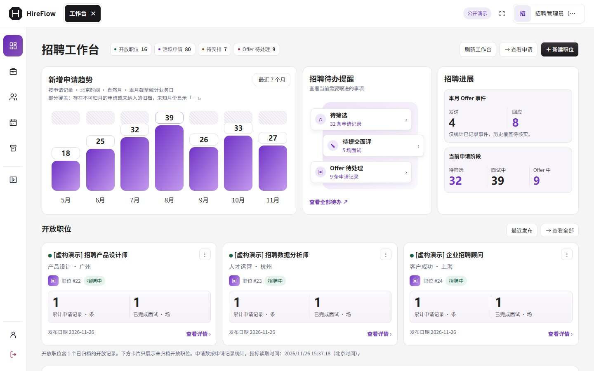
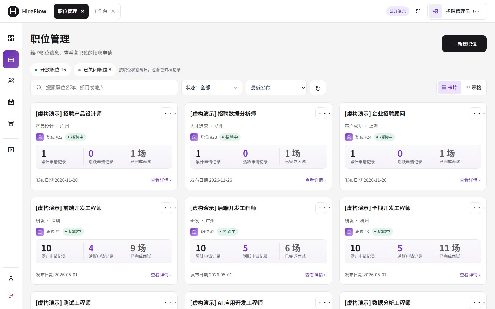
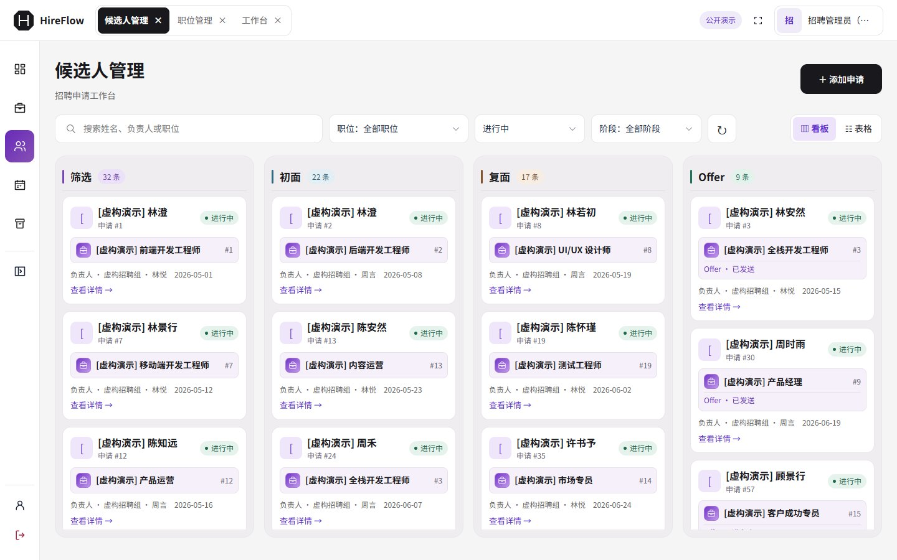
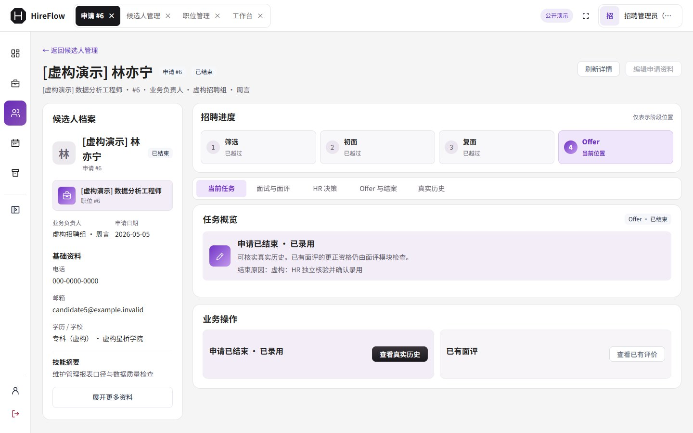
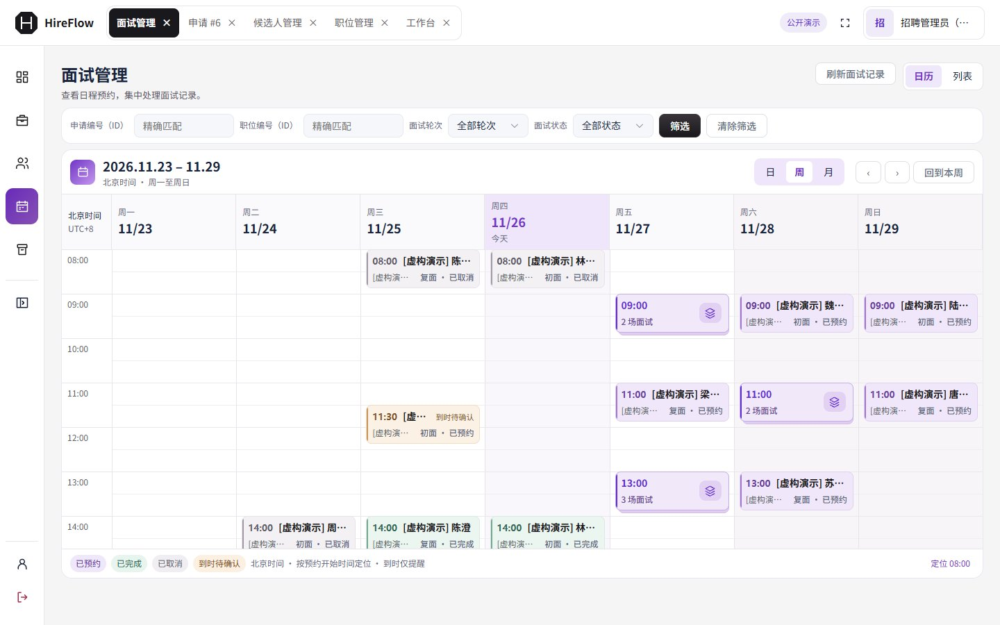

# HireFlow

HireFlow 是面向小型企业和招聘团队的招聘流程协作后台。团队可以从职位和申请出发，在同一个工作区安排面试、记录面评、推进招聘决策，并追溯实际发生的业务操作。

**产品 V4.0.0，视觉设计 V4.1，业务 API 继续使用 `/api/v3`。** [正式入口](https://hireflow.pixelweave.xyz/) 供已授权用户登录。 [公开演示](https://hireflowdemo.pixelweave.xyz/) 运行 V4.0.0。旧演示链接会重定向至新域名。演示账号 `demo_admin`，密码 `a123456`。公开 Demo 使用共享虚构数据，请勿录入真实个人信息。正式模式使用独立账号、服务配置和持久化数据库。

V4 集中开发已结束，进入低频维护。发布源码以 [GitHub Release v4.0.0](https://github.com/gielensras471-creator/hireflow/releases/tag/v4.0.0) 为准。

## 功能

| 工作区 | 能力 |
| --- | --- |
| 招聘工作台 | 历史申请趋势、Offer 事件统计、阶段分布、开放职位、六类待办和今日面试 |
| 职位与申请 | 职位卡片、表格及独立详情，申请四阶段看板、表格与单阶段专注视图 |
| 申请详情 | 当前任务、面试与面评、HR 决策、Offer 与结案、真实历史 |
| 面试管理 | 北京时间日、周、月历，同位置事件聚合、事件面板及全局列表 |
| 账号与历史 | 个人中心、正式账号资料与密码、工作偏好、只读旧档 |

每条 CandidateRecord 对应一次职位申请，以稳定 ID 关联职位。招聘阶段、申请生命周期、Offer 状态与最终结果分别记录。面试完成和面评提交后仍需 HR 独立决定是否晋级，Offer 接受后还需确认录用。符合条件的缺评晋级必须说明理由。业务命令用版本和幂等键校验，业务写入、审计事件和回执随数据库事务提交。正式账户更改密码时递增认证版本，使先前签发的令牌失效。

## 实际运行截图

截图来自本地隔离 Demo，数据均为虚构。

| 招聘工作台 | 职位管理 |
| --- | --- |
|  |  |
| 候选人管理 | 申请详情 |
|  |  |



## 工程与运行

前端使用 Vue 3、TypeScript、Vue Router、Pinia、Axios、Element Plus、ECharts、Vite 和 Sass。后端使用 Node.js、Express、`node:sqlite`、JWT 与 bcryptjs。工程检查采用 Node 原生测试运行器、ESLint、vue-tsc，主要流程另以真实浏览器验证。

项目声明 Node.js ≥ 24.15.0。安装时使用与仓库锁文件兼容的 pnpm。

```sh
pnpm install --frozen-lockfile
pnpm dev:v3
pnpm test
pnpm run lint
```

本地隔离 Demo 先执行 `pnpm run build:demo`，再执行 `pnpm run start:demo`，默认端口 3302。正式前端执行 `pnpm run build:v3`，正式 API 使用 `pnpm run start:v3` 并依赖获准配置和预检后的数据库。普通兼容构建执行 `pnpm build`。浏览器构建变量应只包含公开配置，服务端密钥由运行环境注入。[运行与维护](docs/operations/V4运行维护.md)

## 验证范围

冻结业务 AC-01～36 已在集成回归中通过。发布冻结时的全量测试 259 通过、0 失败、2 条平台条件跳过，ESLint、类型检查及三种构建通过。综合验收有 165 组浏览器与视口组合，覆盖 Chrome、Edge、Firefox、Playwright WebKit，另有代表性原生 200% 缩放检查。Owner 已通过正式系统及公开 Demo 的线上验收。实体手机、真实 Safari 和实际读屏未纳入该验收。

[版本记录](CHANGELOG.md) · [架构](docs/architecture/V4技术架构.md) · [API](docs/architecture/V4接口合同.md) · [数据库](docs/architecture/V4数据库设计.md)

沿用项目 MIT 许可与第三方声明。
