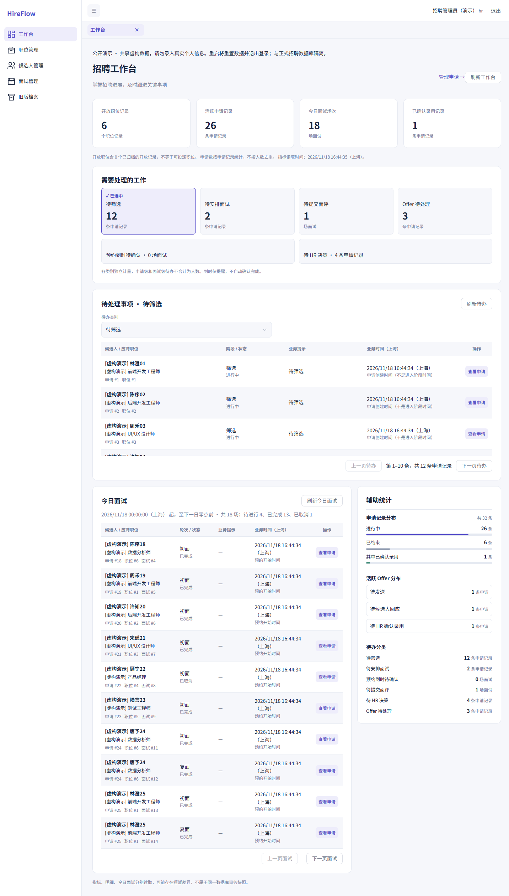

# HireFlow V3

HireFlow 是一个面向小型招聘团队的招聘管理系统，也是一个可以直接操作的个人作品集项目。它把职位、申请、面试、面评、晋级、Offer 和录用确认串联在同一条流程里，保留每次操作的记录。

**[打开 HireFlow 在线 Demo](https://demo.pixelweave.xyz/)**

公开演示账号为 `demo_admin`，密码为 `a123456`。演示使用共享的虚构数据，请勿录入真实个人信息。线上数据每天北京时间 04:00 恢复至初始状态，届时需重新登录。



## 可以体验什么

- 在工作台查看招聘待办、今日面试和各阶段统计。
- 新建职位及候选人申请，安排初面和复面，提交和更正面评。
- 由 HR 决定晋级或淘汰。完成面试或提交面评后，仍需作出晋级决定。
- 准备、发送和跟踪 Offer。候选人接受后，HR 仍需单独确认录用。
- 在申请详情查看招聘历史、业务事件和操作记录。

## 本地运行 Demo

需要 Node.js **24.15.0 或更新版本**和 pnpm **9 或更新版本**。

```bash
git clone https://github.com/gielensras471-creator/hireflow.git
cd hireflow
pnpm install --frozen-lockfile
pnpm run build:demo
pnpm run start:demo
```

打开 [http://127.0.0.1:3302/](http://127.0.0.1:3302/)，使用上面的公开演示账号。本地 Demo 默认绑定回环地址，启动端口可通过 `DEMO_PORT` 设置。每次重启都会重新生成虚构数据和会话签名密钥，旧会话随之失效。

```bash
pnpm test
node --test tests/demo-v3.test.js
```

## 技术架构

前端采用 Vue 3、TypeScript、Element Plus、Pinia 和 Vite，后端采用 Express、Node.js 原生 SQLite 和 JWT。Demo 使用同源 `/api/v3` 和独立的内存数据库，启动时通过现有业务服务生成 6 个职位、32 份申请、18 场面试和 12 条面评。数据、事件、命令回执和工作台统计共享同一数据源。本地运行只需仓库源码及锁文件。

| 模式 | 构建 / 入口 | 数据和会话 |
| --- | --- | --- |
| Demo | `pnpm run build:demo` → `dist-demo`，`pnpm run start:demo` | 独立内存 SQLite 和随机签名密钥 |
| 正式 V3 | `pnpm run build:v3` → `dist-v3`，`pnpm run start:v3` | 持久化 SQLite、独立配置和认证，参见[运行说明](docs/operations/v3-local-production.md) |

[MIT 许可](LICENSE) · [第三方声明](THIRD_PARTY_NOTICES.md)
