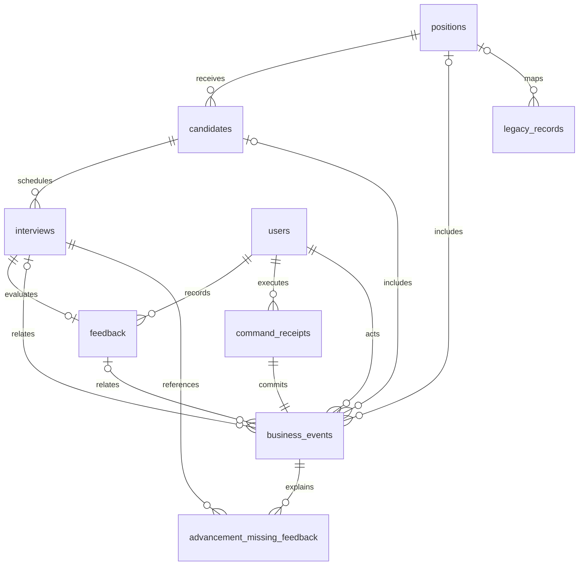

# V4 数据库设计

以 `server/db/schema-v3.js`、`v3-auth-migration.js` 和 `server/services` 为基线。A+ 保留一条 `candidates` 行对应一次职位申请。各表为 STRICT；整数时间以源码约定存储，业务展示按 `Asia/Shanghai`，账户创建和更新时间来自 SQLite 文本时间。

| 表 | 字段与约束 |
| --- | --- |
| users | 整数 id 主键、唯一 username、password_hash、name、role、department、email、phone、created_at、updated_at 为文本；认证迁移加正整数 auth_version。 |
| schema_migrations | 文本 version 主键、script_sha256、source_fingerprint、executor、report_json，applied_at 为整数，迁移记录不可改。 |
| positions | 整数 id、version、可空 deleted_at；title、department、location、status、publish_date、description 为文本。status 仅 open/closed。状态归档及标题索引。 |
| candidates | 整数 id、position_id、created_at、version、可空 closed_at；文本 name、education、school、phone、email、owner、skills、experience、note、applied_date、stage、application_status、可空 outcome、offer_status、closed_reason。职位 FK 禁止变更。职位、待办状态与申请日期索引。 |
| interviews | 整数 id、candidate_id、scheduled_at、created_at、version、可空 completed_at/cancelled_at；文本 stage_scope、interviewer_name、note、status、可空 cancel_reason。申请和轮次固定，每申请至多一条 scheduled。按申请轮次、状态及时间索引。 |
| feedback | 整数 id、唯一 interview_id、recorded_by_user_id、submitted_at、revision；文本 reviewer_name、recommendation、reason。原录入者、场次及提交时间固定，记录者有索引。 |
| command_receipts | 文本 command_id 主键、idempotency_key、request_sha256、result_json，整数 actor_user_id、committed_at。操作者与键唯一，追加写。 |
| business_events | 整数 id、各实体引用、aggregate_version、actor_user_id、occurred_at；文本 aggregate_type、event_type、command_id、actor_name_snapshot、reason、旧值/新值/上下文 JSON。回执一对一，聚合与版本唯一，按聚合、时间、面试、面评、操作者索引。 |
| advancement_missing_feedback | 整数 event_id、interview_id、candidate_id，文本 stage_scope。事件和场次复合主键及一致性外键，只有包含原因的晋级事件可记录。 |
| legacy_records | 文本 source_key、entity_type、raw_json、facts_json、mapping_status，整数 legacy_id、可空 mapped_position_id、imported_at。来源、类型、旧 ID 复合主键，唯一职位映射才有外键，按映射职位和类型索引。 |

业务命令在 `BEGIN IMMEDIATE` 下完成资格、并发校验、业务更新、回执和事件。面试完成后阶段保持，面评更正留下真实快照。Offer 接受、拒绝、合法结案及确认录用分别记录。更改密码以当前认证版本和散列进行条件更新，密码与认证版本在单条 SQL 中原子修改。旧档导入封存，导入时间与历史发生时间分别理解，未知事实原样保留。
