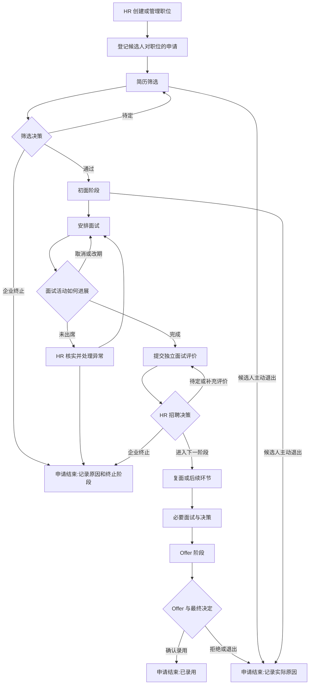

# HireFlow V3.0｜03 招聘业务流程与状态规则（S1-02 待验收草案）

> 日期：2026-10-30  
> 责任对话：02｜V3.0 产品研究与需求分析  
> 状态：**业务研究草案／待 01｜项目总控验收**；非最终状态机、非数据库设计、非 API 规格、非 MVP 冻结。  
> 输入：R01 官方竞品研究、R02 异常流程讨论、R03 用户场景、R04 固定基线源码研究与模型 A/B 对比。

## 0. 已确认的产品方向与待确认的实现细节

| 决策 ID | 用户确认的原则 | 当前边界 |
|---|---|---|
| DEC-R01-01 | 招聘阶段、面试状态、面评和招聘决策分离 | 具体枚举、记录载体和权限未冻结 |
| DEC-R02-01 | 面评未齐时采取**柔性校验**：提示缺失，HR 可说明原因后推进，保留操作记录 | 未定哪些评价算“必需”、谁有权限、如何存储 |
| DEC-R03-01 | 以 HR 为主要用户，兼顾面试官、用人经理 | 不代表完整 RBAC 已批准 |
| V3 产品定位 | 保留企业招聘管理平台，不转为个人求职工具，不推翻现有项目 | 不修改源码或启动 UI 重设计 |

来源：本对话用户逐轮确认；主控总纲 v1.0 §1、§2、§4。

## 1. 术语表：不要把不同类型的状态写成一个字段

| 术语 | 定义 | 例子 | 不能误解为 |
|---|---|---|---|
| Candidate（人） | 人的身份、联系方式和背景资料 | 张三，联系电话 | 一定只申请一个职位 |
| Position / Job（职位） | 企业的招聘岗位 | 前端实习生 | 用职位名称作为唯一标识 |
| Application / Job Consideration（职位申请） | 某人对某职位的一次招聘过程 | 张三申请前端岗位 | 必须立刻有独立 `applications` 表 |
| Stage（招聘阶段） | 申请当前位于哪个流程环节 | 筛选／初面／复面／Offer | 是否已经面试完成、是否已录用 |
| Interview（面试活动） | 某次预约或实际面试活动 | 10月30日技术初面 | 晋级招聘阶段 |
| Interview Status（面试状态） | 单次面试的进展 | 已预约／已完成／已取消 | 面试推荐通过／招聘通过 |
| Feedback（评价） | 评价人对候选人的专业判断及证据 | 推荐通过、优缺点 | HR 的最终决定 |
| Decision（招聘决策） | 获授权的人决定下一步招聘动作 | 晋级、终止、暂缓 | 仅是改变前端按钮的标签 |
| Application Outcome（申请结果） | 申请结束时的结论、终止方与原因 | 录用／企业淘汰／候选人退出 | 招聘阶段“淘汰” |
| Task / Work Item（待办） | 需要处理的动作，可以推导，也可以单独建模 | 待排面／待面评／待决策 | 一定需要单独的任务数据库表 |
| Event（业务历史） | 已真实发生的、可追溯的操作 | 谁何时安排或取消面试 | 根据当前阶段推断出来的虚拟时间线 |

**关键原则**：概念分离不必等于物理数据库表一一对应；先确认语义再决定表结构。

## 2. 通用招聘路径（建议性业务抽象）

注：该图强调业务事件分离，**不是每个岗位都必须两轮面试，也不是已批准的强制状态机**。所谓“安排面试”可以作为进入面试阶段后的动作，但不应把预约本身无条件视为筛选通过；规则待 PRD 确认。

## 3. 一个完整例子：面试完成、评价提交、HR 决策分开

假设张三已进入“初面阶段”：

| 顺序 | 发生的事实 | 招聘阶段 | 面试活动 | 面评 | HR 待办 |
|---|---|---|---|---|---|
| 1 | HR 确认进入初面 | 初面 | 尚未安排 | 无 | 安排面试 |
| 2 | 预约已确认 | 初面 | 已预约 | 无 | 等待面试 |
| 3 | 面试实际完成 | 初面 | 已完成 | 尚未提交 | 跟进面评 |
| 4 | 面试官提交“推荐通过” | 初面 | 已完成 | 已提交 | 作出决定 |
| 5 | HR 决定晋级 | 复面 | 旧面试仍已完成 | 保留原评价 | 安排下一轮 |

**不能**因为第 3 步直接跳到复面；**不能**因为第 4 步自动生成“HR 已批准”的事件。

柔性校验例子：第 4 步有两个预期面试官但只有一个提交面评；HR 选择继续，应显示尚缺哪份评价，要求填写业务原因（例如“紧急招聘，先进入后续评估”），记录真实操作账号和时间。不能补造另一位面试官的通过意见。

## 4. 生命周期与状态——候选枚举，**不是最终数据库类型**

### 4.1 招聘阶段 Stage

拟讨论 `screening → first_interview → second_interview → offer`。这里的 Offer 只表示招聘到该环节，**不等于 Offer 已发送或已录用**。是否需要 `hold`、跳轮、额外 HR 面或更通用的阶段配置，留待 PRD。

### 4.2 申请生命周期／结果

可研究 `active / closed` 与关闭原因 `hired / company_rejected / candidate_withdrew / offer_declined / other`。这只是示例词汇表；“拒绝 Offer”是否单独为关闭原因还是细分候选人退出类型，尚未决定。

**必须保留关闭时所处阶段，不能只保存 rejected。** 对旧版历史数据无法知道被淘汰时所处阶段的，不得凭当前字段编造。

### 4.3 面试活动 Interview Status

现有 `scheduled / completed / cancelled` 是可复用基础。但这些值本身不能表达“面评未交”或“待 HR 决策”。未出席、改期、重排可考虑作为事件或独立字段，而不是盲目扩大枚举。

### 4.4 面评与决策

面评的推荐意见（如 recommend / not_recommend / undecided）与 HR 的推进／终止／暂缓决定分开。面试完成时间、反馈提交时间、负责人决策时间分别记录。示例值均须 PRD 阶段复核。

### 4.5 待办可以是派生计算

例如：活跃申请处于初面、且没有有效待进行面试 → “待安排”；面试明确完成但必要评价尚缺 → “待面评”；评价已具备但未记录招聘决策 → “待决策”。

必须先决定业务口径，避免把“待办项数量”误称为“待处理候选人数”。如果一个候选人同时存在两个待办，是否重复计数需明确。

## 5. 招聘负责人／面试官／用人经理职责

| 角色 | 核心目标 | 典型操作 | 研究性权限边界 |
|---|---|---|---|
| HR（主要用户） | 控制招聘流程、跟进待办 | 初筛、安排、推进、终止、查看历史 | 应由已认证账号留痕；必要权限校验由后端执行 |
| 面试官 | 提供评价依据 | 查看必要资料、填写或修订自己评价 | 不应直接把推荐意见当晋级命令 |
| 用人经理 | 判断岗位匹配度 | 查看候选人与面评、提供意见 | 是否拥有最终决策权限待讨论 |
| 管理员 | 基础账户配置 | 管理系统使用者 | 不承诺复杂 RBAC |
| 候选人（外部参与者） | 知道安排、反馈和结果 | 接受／更改约面，接受／拒绝 Offer | V3.0 不承诺候选人门户或消息自动同步 |

以上为角色职责假设，**未经过真实 HR/用人经理/面试官访谈验证**。

## 6. 关键业务规则草案

| ID | 草案规则 | 类型 | 需进一步确认 |
|---|---|---|---|
| BR-01 | 面试完成不自动推进候选人招聘阶段；HR 决策应是单独动作。 | 已确认原则的落实建议 | 具体决策入口、权限 |
| BR-02 | 招聘阶段的合法转换必须由后端校验，不能只依赖前端隐藏按钮。 | 主控要求 | 跳轮与回退规则 |
| BR-03 | 面评未齐时先告知缺失信息，HR 可说明原因推进并留痕。 | **用户已确认研究方向** | 何为必需评价、可覆盖范围 |
| BR-04 | 面试取消、改期不应自动导致职位申请进入下一招聘阶段。 | 建议 | 再次预约如何表示 |
| BR-05 | 企业淘汰与候选人主动退出分开记录，并保留终止时所在阶段。 | 建议 | 最小终止原因列表 |
| BR-06 | 已结束申请恢复后，原先终止信息不可无痕删除。 | 建议 | 恢复权限、历史呈现 |
| BR-07 | 操作事件应有操作人、动作、时间、关联对象以及必要原因。 | 主控要求衍生 | 事件范围、隐私与保留期限 |
| BR-08 | 职位与申请用稳定 ID 建立关联，不仅凭职位名称。 | 源码差距衍生 | 数据迁移冲突处理 |
| BR-09 | 招聘统计口径必须明确，避免缓存人数与真实申请关系不一致。 | 源码差距衍生 | 统计如何定义历史／当前 |
| BR-10 | 创建和编辑面试时要核对目标申请是否仍活跃以及该轮是否合理。 | 建议 | 允许补面、特殊面、并行面 |

**暂不将以上全部认定为 MVP P0。** 具体规则实现颗粒度须经过 PRD 取舍。

## 7. 异常场景矩阵（研究案例，非功能承诺）

| ID | 情况 | 应保留的事实／待讨论的处理 | 禁止的误解 |
|---|---|---|---|
| E01 | 初面阶段未安排面试 | 保留初面阶段，产生待安排提示 | 自动认为已经面试 |
| E02 | 候选人提出改期 | 修改预约，保留改期历史 | 直接晋级或抹掉原安排 |
| E03 | 面试取消 | 留取消原因，允许按规则再安排 | 取消等于淘汰 |
| E04 | 候选人未出席 | 确认是否失联、重约或退出 | 默认算面评不通过 |
| E05 | 预约时间已过去，但面试未确认举行 | 待核实面试事实 | 单凭时钟判定真实完成 |
| E06 | 面试官未交面评 | 提示待面评，HR 可跟进 | 自动捏造评价 |
| E07 | 多位面试官意见不一致 | 保留独立评价，交给负责人决策 | 用最后一份覆盖先前评价 |
| E08 | 已提交评价被修订 | 记录修订或编辑标记、必要依据 | 无声修改关键决策证据 |
| E09 | HR 在面评未齐时晋级 | 风险提示、原因、操作人、时间 | 要求系统自动补齐通过结论 |
| E10 | 跳过面试轮次 | 留必要理由和批准动作 | 伪造该轮面试已完成 |
| E11 | 招聘阶段回退 | 保留原阶段、目标阶段、时间及原因 | 重写历史当作未发生 |
| E12 | 企业淘汰 | 记录终止阶段、终止方和理由 | 与候选人退出混为一谈 |
| E13 | 候选人主动退出 | 记录候选人退出原因 | 统计为企业拒绝 |
| E14 | Offer 被拒绝 | 与“已发出”“已接受”“已录用”区别 | Offer 阶段等于录用成功 |
| E15 | 已终止的申请恢复 | 追加恢复事件，保留旧终止事实 | 删除原事件 |
| E16 | 一人申请多个岗位 | 各申请独立招聘阶段与结果 | 在不同岗位共用一个 stage |
| E17 | 职位关闭仍有活跃申请 | 提醒 HR 处置或按明确规则保留 | 所有申请被默默淘汰 |
| E18 | 同名职位或重复候选人 | 按稳定 ID；歧义进入人工核实 | 仅凭文本名称自动合并 |
| E19 | 删除候选人或面试 | 区分业务归档与真实数据删除 | 审计与隐私需求被忽略 |
| E20 | 多次点击晋级或重试请求 | 后端保证幂等或明确冲突响应 | 重复生成两次晋级事件 |

事件 E17–E20 是为补齐对现有源码的风险检查而新增的研究情景，不应称为已发现的生产事故。

## 8. 数据模型 A/B 对规则的影响

**已进行 R04 研究，结论仍待决策：**

- **A+（最小改造）**：现有一条 Candidate 记录代表某一次职位申请；增加稳定 `position_id` 和独立业务结果／面评／事件即可支持完整单申请流程，同一个人跨职位可能重复存储个人资料。
- **B（独立 Application）**：Candidate 个人档案与 Application 职位申请分离，更自然支持同一人多岗位、共享联系方式和独立申请历史，但有更大的 API／迁移／测试影响。
- **共同要求**：BR-01～BR-09 不以独立 Application 表为前提；不要把修复自动晋级、统计和历史问题误称为 B 独有收益。

详见 `HireFlow_R04_数据模型A_B对比研究.md`。本文件不得被 Codex 视为批准的数据库变更指令。

## 9. 与 V2.1.1 源码差距的对应关系

| 范围 | 已核验的静态事实 | 对应研究规则 |
|---|---|---|
| `src/config/recruitment.ts`、`src/views/interviews/index.vue` | 初面完成自动推复面、复面完成自动推 Offer；分两次 API 提交 | BR-01/02、E20 |
| `server/routes/candidates.js` | 阶段校验只验枚举，不验允许的转换；计数按职位名称更新 | BR-02/08/09 |
| `server/db/database.js` | `candidates` 持有职位文字／阶段；`interviews` 关联候选人 | BR-08，A/B 模型权衡 |
| `src/views/candidates/detail.vue` | 当前阶段推导出虚拟“进度时间线” | BR-07 |
| `src/views/dashboard/index.vue` | 待处理数 = 筛选候选人数 + scheduled 面试数 | BR-09 |
| `server/routes/interviews.js` | 面试状态有 scheduled/completed/cancelled；无独立评价和修订历史 | BR-03/04，E02/03/08 |

代码证据均来自 Git 提交：`490b9ee2f1985b37052feebefd73605aa0dba1ab`，仓库 https://github.com/gielensras471-creator/hireflow 。这只是静态源码核验，**未进行失败注入、迁移演练或生产验证**；本地 Codex 审计文件尚需总控核对。

## 10. PRD 前需要确认的问题

1. **Applicant 概念是否独立建表？** 是否把同一人跨岗位共享档案作为 V3.0 必需演示场景？
2. **Offer 的范围？** 只是 Offer 阶段与最终录用结果，还是需记录发送/接受/拒绝等最小活动？
3. **面评粒度？** 单面单评、多人独立面评、推荐项与评估维度的最小集合？
4. **HR 决策规则？** 跳轮／回退／恢复、终止原因与已结束申请的可操作性？
5. **权限边界？** 单账号演示是否能诚实呈现操作人？若支持多账号，最小授权规则是什么？
6. **统计口径？** 当前活跃申请数、申请总数、待处理项、待处理人次如何区分？
7. **迁移策略？** 旧职位名称匹配歧义、旧版 rejected 无历史原因如何不伪造事实？

这些问题属于 S1-03 PRD 取舍或总控审查，不阻碍把 S1-02 作为**研究草案**提交验收。

## 11. 来源与限制

- 正式竞品来源及事实索引见 `02-竞品研究.md` [S01]–[S12]。
- 固定审计源码见本文件第 9 节及 `HireFlow_R04_数据模型A_B对比研究.md`。
- 当前没有真实企业用户访谈，场景是从产品资料与代码推导的**可检验假设**。
- 规则并未完成用户逐条签字，也没有形成任何已批准的数据库或 API 规格。

## 12. S1-02 自检

- [x] 概念上区分招聘阶段、面试状态、评价、决策、待办、申请结果及事件。
- [x] 提供主要流程图、角色场景、可追踪的规则候选编号。
- [x] 覆盖改期、取消、未出席、迟交面评、多面评冲突、强制推进、终止、恢复、Offer 拒绝等异常。
- [x] 把已确认原则与未冻结的字段及规则隔开。
- [ ] **等待 01｜项目总控按主控总纲验收**。
