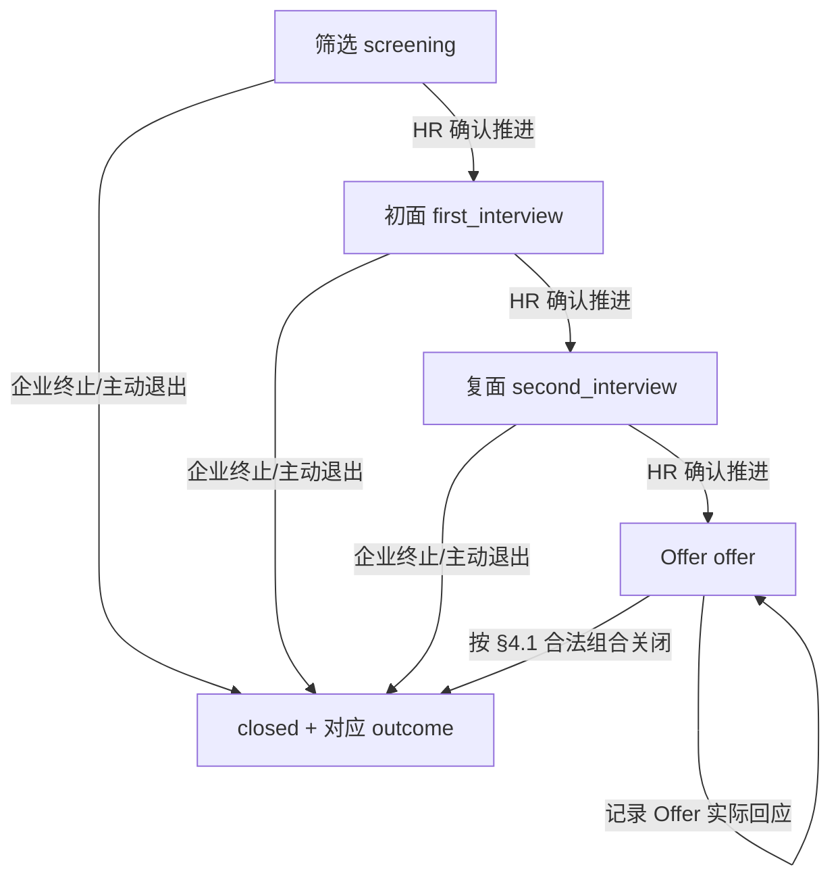

# HireFlow V3.0｜产品需求文档（PRD）

> **文档版本**：v1.0 · **Owner 正式批准冻结** · 2026-11-02  
> **状态**：**已冻结（DEC-S1-03-FREEZE-01）**。总控已完成 R1～R3 与时间口径复核，Owner 于 2026-11-02 在对话 A 明确批准；**产品需求冻结不代表代码实现或 AC 测试通过**。  
> **产品负责人/确认人**：项目 Owner；**撰写**：02｜V3.0 产品研究与需求分析  
> **开发基线**：HireFlow V2.1.1；静态审计提交 `490b9ee2f1985b37052feebefd73605aa0dba1ab`  
> **用途**：作为后续设计、技术方案、任务切片与验收的产品依据；**不是数据库迁移脚本、接口契约或立即执行的 Codex 指令**。

## 0. 决策依据、事实边界与版本状态

### 0.1 输入资料

1. `HireFlow_V3.0_项目主控总纲_v1.2_正式版.md`：最新项目调度、权限边界、阶段与冻结状态。
2. `02-竞品研究.md`：飞书招聘、Greenhouse、Ashby 的官方事实与 F/I/P 边界；S1-01 已验收。
3. `03-招聘业务流程与状态规则.md`：业务术语、正常与异常流程；S1-02 **研究草案**已验收。
4. `HireFlow_R04_数据模型A_B对比研究.md`：A+ 与独立 Application B 的比较；研究通过，原报告的未决事项由本次确认覆盖。
5. V2.1.1 固定基线相关源码：`server/db/database.js`、`server/routes/{candidates,interviews,positions}.js`、`src/config/recruitment.ts`、`src/views/{candidates,interviews,dashboard}/*`。该证据是**静态源码检查**，不是运行测试。

### 0.2 已确认的产品决策（2026-10-30）

| 决策编号 | 已确认内容 | 对本 PRD 的约束 |
|---|---|---|
| DEC-R01-01 | 招聘阶段、面试状态、面评、决策分开表达 | 不再用单个候选人 `stage` 表达全部业务 |
| DEC-R02-01 | 面评未齐可由 HR 说明原因后推进，操作可追溯 | 柔性校验有提示、原因和真实事件，不能无条件自动推进 |
| DEC-R03-01 | HR 为主要用户，兼顾协作 | 不扩展成复杂多角色协作系统 |
| DEC-S1-03-01 | 采用 **A+** 数据模型 | 以一条 CandidateRecord 代表一次职位申请；不拆独立 Application 表 |
| DEC-S1-03-02 | 四阶段 + 独立 active/closed + Outcome；P0 禁止任意跳阶段/回退 | `screening → first_interview → second_interview → offer`；结束不覆盖阶段 |
| DEC-S1-03-03 | 一场面试一份评价；同阶段可顺序多场；保留柔性校验 | 多面试官对同一场面试独立面评是 P1 |
| DEC-S1-03-04 | Offer 只做最小人工记录 | 不含审批、自动发送、电子签署 |
| DEC-S1-03-05 | 真实 HR 账号操作，面试官可由 HR 代录 | 面试官姓名 ≠ 实际操作账号；历史必须保真 |
| DEC-S1-03-06 | 采用经确认的 P0/P1/不做清单及核心验收方向 | P1 不作为 P0 发布门槛 |

> 上述方向及本 PRD v1.0 业务规格已由 Owner 批准冻结；具体**物理表结构、接口路径和技术实现**仍由 E2-01 评审，但不得擅自改动本版业务语义。冻结后新增或修改 P0 须回 01 总控走变更记录，不代表 Owner 在冻结前逐字段亲自讨论。

## 1. 背景、问题与目标

### 1.1 定位

HireFlow 是面向**小型企业或小规模招聘团队**的招聘流程协作后台，**以 HR / 招聘负责人为核心操作人**，帮助其关联职位与申请、安排面试、整理专业评价、作出招聘决定、记录最终结果并追溯历史。它不是个人投递工具，也不是全功能企业 ATS。

### 1.2 V2.1.1 已核实问题

- 完成初面可能自动晋级复面；完成复面可能自动进入 Offer，且两个步骤由独立请求完成，存在部分成功风险。
- `candidates` 将职位名称、个人信息和招聘阶段混放；`rejected` 被当作阶段；职位人数按**职位名称**更新，而非稳定 ID；候选人表单存在写死职位选项。
- 面试已有 `scheduled/completed/cancelled`，但无独立结构化面评与真实事件历史。
- 详情“招聘进度”从当前状态推演，不代表实际操作记录；Dashboard 的待办总数是筛选申请数和已安排面试数的简单相加。
- 现有 JWT 登录已可复用，但已审阅的业务接口没有形成明确的角色授权边界。

以上为指定提交静态源码事实与推断，**没有声称这些风险已在生产环境触发**。详细路径及论证见 R04。

### 1.3 产品目标与成功判断

1. HR 能演示从**新建职位申请 → 初筛 → 初面 → 评价 → 复面 → Offer → 最终结果**的完整流程。
2. 面试完成、推荐结果和 HR 业务决定相互独立；后端拒绝不合法操作，跨实体业务变更一致。
3. 每项重要招聘决策都有可追溯的事实记录，不凭当前状态伪造历史。
4. 同名职位、职位更名与旧数据迁移不破坏职位关联或人数统计。
5. Dashboard 展示有明确定义、能够由实际记录核对的任务和指标。
6. 保持 Vue3/TS、Pinia、Element Plus、Express、SQLite 的现有基础；以**真实可复现的验收流程**证明作品价值，不编造效率提升数字。

**不宣称**已通过真实 HR 访谈验证需求；用户场景是根据已验收的官方资料和现有系统问题形成的研究性假设。

## 2. 用户角色与典型场景

| 角色 | V3.0 权限和作用 | 不承诺的能力 |
|---|---|---|
| HR / 招聘管理员（P0 真实账号） | 登录；维护职位和申请；安排/完成/取消面试；代录面评；推进/终止；记录 Offer 与查看历史/待办 | 无组织级复杂 RBAC、全套审批体系 |
| 面试官（业务参与者） | 面试记录保存面试官姓名；面评显示专业评价人姓名 | P0 不提供独立面试官登录和专属待办门户 |
| 用人经理（业务参与者） | 作为职位/评价/决策的业务背景参与者，HR 可查看有关信息 | P0 不提供独立账号/审批入口 |
| 候选人（外部参与者） | 是招聘流程的对象，可以通过 HR 手动登记是否接受 Offer | 无候选人门户或自动通知 |

**主要场景**：HR 同时管理几个职位，早上查看待筛选、待安排、待录入面评和待决策；操作某个职位申请、安排初面、记录改期，随后根据评价决定晋级；必要时缺失面评但说明原因推进，最后登记 Offer 结果并可追溯操作。

**辅助场景**：一个候选人分别申请两个岗位。A+ 中这是两条独立 CandidateRecord，阶段、面试和结果互不污染，但个人联系方式**不自动共享**；不能据此宣称系统已有统一人才身份档案。

## 3. 范围、优先级及非目标

### 3.1 P0：构成 MVP 核心闭环

| ID | 能力 | 业务收益 |
|---|---|---|
| P0-01 | 稳定职位 ID 关联、人数口径及基本职位/申请管理 | 解决同名职位和悬空关联风险 |
| P0-02 | 四阶段 + 申请生命周期/结果分离 | 记录实际所在阶段与结束原因 |
| P0-03 | HR 明确决策与后端转换校验 | 不再由面试完成自动晋级，防止绕过前端 |
| P0-04 | 面试安排、改期、完成、取消与活动独立 | 处理正常及主要异常面试情况 |
| P0-05 | 一场面试一份独立结构化评价 | 推荐意见与招聘决定分开 |
| P0-06 | 缺面评/跳过面试的柔性推进 | 提示风险、理由推进和操作追溯 |
| P0-07 | Offer 最小人工记录与录用结果 | 不将 Offer 阶段等同录用 |
| P0-08 | 真实业务事件历史及必要修改/删除防护 | 记录是谁、何时、为什么执行 |
| P0-09 | HR 任务型 Dashboard、可核验统计 | 区分工作项、申请数和面试数 |
| P0-10 | 旧数据安全兼容、关键测试与演示数据 | 可交付、可解释、可回滚 |

### 3.2 P1：后续可选增强，不作为 V3.0 P0 发布门槛

| ID | 内容 | 用户故事/价值 | 操作链与边界 | P1 验收标准（仅在批准实施时生效） |
|---|---|---|---|---|
| P1-01 | 同一场面试的多人独立评价 | 用人经理需要比较不同面试官意见 | 关联一场面试多个 Feedback，各自归属；需真实账号或清楚的代录身份 | 多份面评不互相覆盖，历史留痕，缺失判断准确 |
| P1-02 | 已结束申请恢复 | HR 纠正误终止或重新考虑 | 追加恢复事件，不删除旧结论 | 恢复后业务继续，原终止事实仍可见 |
| P1-03 | 解释性回退与跳轮 | 个别岗位有特殊面试过程 | 需原因及合法转换白名单 | 回退/跳过记录前后阶段，后端防止任意写入 |
| P1-04 | 更细的未出席管理 | HR 识别爽约和重约 | 单独记录未出席事实与处理 | 不自动当作企业淘汰或面试不通过 |
| P1-05 | 更多评价维度 | 面试官需要分项表达能力证据 | 可增加少量能力维度，不引入模板引擎 | 推荐结论及依据一致，评分不自动决定晋级 |
| P1-06 | 招聘漏斗与周期分析 | HR 向管理者汇报招聘表现 | 依赖真实阶段事件和口径 | 指标能由事件追溯，不用当前阶段倒推历史 |

### 3.3 V3.0 明确不做

AI 简历解析/匹配/RAG/Agent；自动发送邮件/飞书消息、第三方日历和招聘渠道集成；独立候选人门户；企业级多租户、复杂 RBAC；可配置招聘阶段/流程引擎、评分权重或模板编辑器；完整 Offer 审批/电子合同/入职系统；独立 Candidate + Application 的跨职位共享档案、自动合并去重；无业务理由更换数据库、微服务或重写前端架构。P1 未被另外批准时同样不计入 P0。

## 4. 术语与最小业务数据模型 A+

> **以下是产品逻辑模型，不是最终物理 DDL。** 可继续使用旧表名 `candidates`，但产品语义定义为 **CandidateRecord：一条职位申请记录**。不把身份实体和申请实体分表。

| 对象 | 核心字段/语义（概念层） | 约束 |
|---|---|---|
| Position | `id, title, status(open/closed), ...` | `id` 稳定唯一；展示名称不用于业务主键 |
| CandidateRecord | `id, position_id, name/contact/background, applied_at, stage, application_status, outcome, closed_reason, closed_at, owner` | 新申请必须有真实 `position_id`；一条记录代表一次职位申请 |
| Interview | `id, candidate_record_id, stage_scope, scheduled_at, interviewer_name, status, note, completed_at/cancelled_at` | `stage_scope` 固定为创建时的初面/复面；新建时必须属于当前活跃阶段 |
| Feedback | `id, interview_id, reviewer_name, recorded_by_user_id, recommendation, reason, submitted_at` | P0 同一 Interview 最多一份**当前有效评价**；仅对已完成面试提交；误录允许有痕更正而非另建第二份有效评价 |
| BusinessEvent | `id, candidate_record_id, entity_ref, event_type, actor_user_id, occurred_at, old/new values, reason` | 关键动作与真实账号关联，时间由服务端生成；面评更正需保存原文与修正后内容快照；历史不可无痕覆盖 |
| Offer 记录 | `offer_status`（附属于招聘记录或等效轻量数据）、操作时间与事件 | 仅当 stage=offer；不强制独立 Offer 表 |

**概念说明**：`CandidateRecord` 是数据模型中的中性称谓，界面可继续使用“候选人”，但统计必须写“申请记录数”；不得将重复投递的两条记录宣称为唯一自然人数。相关外键及实际列名由 E2-01 技术评审确定，业务语义不得改变。

### 4.1 申请状态、阶段与结果不变量

| 字段 | 新数据取值 | 业务约束 |
|---|---|---|
| `stage` | `screening` / `first_interview` / `second_interview` / `offer` | 当前或结束时最后阶段；不得用 `rejected` 充当阶段 |
| `application_status` | `active` / `closed` | 活跃或结束 |
| `outcome` | `hired` / `company_rejected` / `candidate_withdrew` / `offer_declined` / `null` | 活跃为 `null`；结束为四种结果之一 |
| `offer_status` | `null` / `preparing` / `sent` / `accepted` / `declined` | 只有 `stage=offer` 才可非空；结束时保留最后已知 Offer 事实 |
| `closed_reason` / `closed_at` | 结束理由 / 服务端时间 | `active` 时均为空，`closed` 时均存在；`hired` 可填写“HR 确认录用” |

#### 4.1.1 新数据合法组合矩阵（P0 强制）

| `application_status` | `stage` | `offer_status` | `outcome` | 说明 |
|---|---|---|---|---|
| `active` | `screening`、`first_interview`、`second_interview` | `null` | `null` | 普通进行中申请 |
| `active` | `offer` | `preparing`、`sent`、`accepted` | `null` | Offer 处理中；`accepted` 仍未正式录用 |
| `closed` | `screening`、`first_interview`、`second_interview` | `null` | `company_rejected` 或 `candidate_withdrew` | 在非 Offer 阶段结束 |
| `closed` | `offer` | `accepted` | `hired` | 仅由 HR 在已接受 Offer 后确认录用 |
| `closed` | `offer` | `declined` | `offer_declined` | 由 `sent` 拒绝操作**原子地**产生 |
| `closed` | `offer` | `preparing`、`sent` 或 `accepted` | `company_rejected` 或 `candidate_withdrew` | Offer 阶段企业终止／候选人退出；保留最后 Offer 事实和结束理由 |

**矩阵外组合对新业务数据一律非法**，尤其包括：非 Offer 阶段 `hired/offer_declined`；`active` 带任何 `outcome` 或 `offer_status=declined`；`closed` 但结果为空；`offer_status=declined` 配 `hired/company_rejected/candidate_withdrew`；以及非 Offer 阶段存在 Offer 子状态。服务端必须在专用招聘决策／Offer 动作中校验，**通用 PATCH 或编辑候选人不能绕过**。闭合时保留原 `stage`，不把阶段改成 `rejected`。

- **关闭条件**：`company_rejected`、`candidate_withdrew` 允许在四个阶段执行；非 Offer 阶段 `offer_status=null`，Offer 阶段保留当时 `preparing/sent/accepted`（若已 `declined`，申请应已按 `offer_declined` 关闭，不能再次关闭）。结束必须有非空原因、服务端时间、实际 HR 操作人；关闭前有效 `scheduled` 面试须完成或取消。
- **录用条件**：只有 `active + stage=offer + offer_status=accepted` 可以执行“HR 确认录用”，原子写入 `closed/hired` 和事件；不在确认录用时重新改变 `offer_status`。不能从 `preparing/sent` 直接录用。
- **拒绝 Offer 条件**：只有 `active + stage=offer + offer_status=sent` 可以执行“候选人拒绝 Offer”；单次后端事务同时写入 `declined + closed/offer_declined + 结束原因/时间 + 事件`。不能把该流程拆成两个允许中间状态外露的请求。
- **关闭后的例外**：禁止常规推进、新建面试、补录尚未提交的历史面评、Offer 变更及再次结束；**唯一 P0 内容更正例外**是 §5.4 的“已提交面评有痕误录更正”，不会改变招聘阶段、结束结果或原决策事实。P0 不恢复关闭申请。
- **旧数据隔离**：旧 `rejected` 可知“已终止／企业淘汰”，但原阶段、结束时间、理由未知；旧 `offer` 的发送／接受事实未知。旧记录允许在迁移兼容层采用 `unknown/null` 等**只读的历史待核实表示**，不属于上表允许的新业务写入组合，不得伪造为合法新历史。如何落库、如何人工核实由 E2-01 审查；未经核实不允许通过普通编辑使其混入可操作的新状态。

### 4.2 阶段转换（新数据 P0）

- **P0 允许的唯一阶段推进**：`screening→first_interview`、`first_interview→second_interview`、`second_interview→offer`。不支持表单任意改阶段、跳轮或回退。每次关闭必须遵守 §4.1.1 的结果矩阵，不能“任何阶段任选任何结果”。
- 筛选阶段推进由 HR 确认；**安排或完成面试、提交推荐通过评价都不触发晋级**。
- 初面、复面推进前：存在当前轮次 `scheduled` 面试时，必须先完成或取消；有 `completed` 但缺面评时，列出缺评面试并要求推进理由；没有完成过面试则要求填写跳过评估理由。柔性规则只放宽缺评/未完成面试的决策依据，不放宽阶段顺序。
- 例外推进的缺评明细及理由成为不可删除的历史事实；旧阶段是否补录及 Dashboard 口径见 §5.5、§5.8。
- `not_recommend` 面评不自动封锁晋级；HR 必须可看到结论。建议在违背明确不推荐意见时补充解释，是否强制不扩展本次冻结范围。
- 后端验证真实账号、当前版本/阶段、合法目标、活动状态及原因；招聘决策与 BusinessEvent 必须原子提交。重复或过期请求不能连跳、重复事件或部分成功。

## 5. 业务流程与 P0 详细需求

### 5.1 P0-01：职位与申请关联

**用户故事**：作为 HR，我希望从真实职位列表选择岗位、查看该岗位的申请数量，并在职位更名后保持关联不变。

**操作链**：创建/维护职位 → 创建申请时选择其 `id` → 申请、面试展示职位信息 → 职位列表展示**关联申请记录数**。

**规则/异常**：
- 新申请的 `position_id` 必须存在，且默认只能关联招聘中（open）的职位；关闭职位不自动淘汰已有申请，提示存在的活跃申请；不能静默删除仍有申请的职位。
- 同名职位按 ID 区分；职位改名不改变申请外键；人员的联系信息不因职位改名发生变化。
- 同一人申请不同岗位在 A+ 中分别生成记录，互不共享阶段/面试/评价/结果。
- 新增/编辑候选人界面使用真实职位数据，不写死职位名称；切换已登记申请的职位属于高风险变更，P0 原则上禁止直接“改岗”，可另建申请，不覆盖旧历史。
- `candidate_count` 不以可人工输入、可自行增减的缓存为权威值；以实际关联记录计算。职位“申请总数”和“活跃申请数”应注明口径。

**验收**：AC-01/02/03/18/19。

### 5.2 P0-02/03：申请生命周期与 HR 决策

**用户故事**：作为 HR，我希望知道申请在何阶段、是否结束、结束理由，并由我而非面评自动决定下一步。

**操作链**：申请处于筛选/初面/复面 → 查看当前面试及评价 → 点击“进入下一阶段”或“结束招聘” → 校验/确认 → 成功后在详情与历史显示实际事件。

**规则/异常**：
- 不存在直接从初面进 Offer 的 P0 操作。前端禁用只是提示，**后端 API 同样拒绝**非法动作。
- 结束结果分为企业淘汰、候选人退出、Offer 被拒和确认录用；**允许的阶段、Offer 子状态与结果严格按 §4.1.1 矩阵**，不能在筛选/初面/复面直接选择 `hired` 或 `offer_declined`。HR 必须选择合法结果并填写必要理由。
- 已关闭申请禁止普通推进、面试新增、Offer 状态变更及旧面评补录；仅 §5.4 已提交面评的有痕误录更正作为特定例外。关闭前若有 `scheduled` 面试，必须先完成或取消并留痕；**不能留下有效悬空预约**。
- 重复操作、并发请求、陈旧页面应安全拒绝或幂等返回，不允许同一操作多次晋级。失败应保持原状态并提示重试。

**验收**：AC-04/05/06/08/10/11/14/15/20/33。

### 5.3 P0-04：独立面试活动

**用户故事**：作为 HR，我需要安排、修改、标记完成或取消某次面试，而不意外改变招聘阶段。

**操作链**：进入初面或复面 → 创建该轮面试（时间、面试官、轮次、备注）→ 必要时改期/取消 → 实际结束后人工确认完成 → 等待/录入评价。

**规则/异常**：
- 状态仅为 `scheduled/completed/cancelled`；“待面评”“待决策”是业务待办，**不是 Interview 状态**。
- 新面试只允许关联当前活跃申请和当前初面/复面阶段，记录创建时 `stage_scope`。同一申请 P0 同一时刻最多一场 `scheduled`，但同一阶段可以**先后**创建多场（前一场已完成或取消）。
- 只有 `scheduled` 可改期、完成、取消；已完成/已取消不能在 P0 普通编辑中改回已安排。改期保留原时间和新时间事件；取消要求理由；取消后可新增一场面试。
- **统一时间规则**：仅依赖当前实际保存的“预约开始时间” `scheduled_at`，不假定已有预约结束时间。按业务时区 `Asia/Shanghai` 解释/展示预约时间，并与服务端统一时间瞬间比较；`status=scheduled` 且 **当前时刻 `now >= scheduled_at`**，显示“预约开始时间已到，待确认面试状态”。达到阈值只生成提示，不自动完成或推断面试已举行。未出席专门状态留 P1，P0 可用取消并注明实际原因，不能自动认定候选人退出。
- 真实完成状态与完成时间为两项业务信息；修改预约/取消均不自动晋级。

**验收**：AC-04/09/17/21/22/36。

### 5.4 P0-05：面评及最小有痕误录纠正

**用户故事**：作为 HR，我希望把面试官的建议和理由作为独立评价保存；录入错误时能修正记录，同时保留原始证据，而不冒充 HR 决策。

**正常操作链**：打开已完成面试 → 输入专业评价人姓名、推荐结论、非空依据 → 已登录 HR 提交 → 在候选人详情查看评价。

**规则/异常**：
- 评价结论 `recommend / not_recommend / undecided`，分别显示“推荐通过／不推荐通过／暂不确定”；理由不可空。
- P0 **一场面试至多一份当前有效面评**；不同面试可各有一份。提交前提为面试 `completed`，且关联申请目前 `active`；已晋级的旧轮次补录还须符合 §5.5。
- 面评保存 `reviewer_name`（专业评价人）与 `recorded_by_user_id`（实际 HR 登录账号）；两种身份不能混同。
- **P0 最小纠错操作（必做）**：已提交评价的录入内容若有误，获授权的 HR 通过明确的“更正面评”操作填写**更正理由**和正确的评价人／结论／理由（必要字段保持有效），提交后原 Feedback 的**当前有效内容**更新；在同一事务中追加不可无痕修改的 `feedback_corrected` 事件，保存**原完整面评快照、新完整面评快照、关联面试、真正操作者、服务端时间及更正理由**。原始 `submitted_at` 和最初录入人事实保留；更正时间/更正者由事件记录。UI 显示“已更正”及原始/更正前后内容的历史入口。
- 更正是**纠正录入事实**，不是为同场新增第二份并行有效评价；不做通用编辑器、多版本审批、撤销面评或复杂版本树。后端阻止普通 PATCH/重复提交无痕覆盖，验证操作人并原子保存。
- **已推进或已关闭后的例外**：HR 仍可对**已存在、已提交**的面评执行上述有痕更正；不得据此自动回退阶段、撤销既有决策、改写历史推荐依据或重新打开已结束申请。详情需要显示“该更正发生在原招聘决策之后”（当时间上成立）。关闭后不允许新增从未提交的面评（见 §5.5）。

**验收**：AC-05/07/23/24/34/35。

### 5.5 P0-06：柔性校验、例外晋级与旧轮次缺评

**用户故事**：作为 HR，我希望在面评未齐时说明原因推进；系统能够解释哪些面评仍缺失，又不会产生永远无人处理的跨阶段待办。

**正常操作链**：在初/复面申请点击晋级 → 系统仅检查**当前轮次**的活动与评价 → 展示缺评面试清单或“本轮尚无完成面试” → HR 填写非空理由 → 后端原子推进并记录例外事件。

**规则/异常**：
- 若当前轮次仍有 `scheduled` 面试，须先完成或取消，不能以“柔性校验”绕过悬空预约。
- 有 `completed` 但缺 Feedback 时，晋级事件必须记录**当时未交评价的面试 ID/轮次、HR 理由、前后阶段、操作者和时间**，并标记“本次晋级已说明原因，允许带缺评推进”。这只是**晋级条件豁免**，不表示面评已提交或已通过；若当前轮没有已完成面试则明确记为“跳过本轮面试评估”。
- **晋级后旧轮次缺评**：属于历史未完成信息，详情保留“原轮次缺评／已说明原因推进”标识及事件。**不再计入 Dashboard 当前‘待面评’全局待办**，避免形成长期无当前负责人入口的待办；但也不能把它显示为“评价齐全”。历史面试仍可被查看。
- **旧轮次补录**：在招聘申请仍为 `active` 时，允许 HR 对**已经列入原晋级例外事件缺评清单**的、原 `stage_scope` 的**已完成**面试记录，手工补录一份原本缺失的评价，填写评价人、结论、理由，保存**实际补录的服务端时间及录入账号**，在历史中标记“晋级后补录”；**不能回填成面试当日提交，不能改变原晋级事件的缺评快照，不触发新决策或阶段回退**。补录后当前面评事实更新，原豁免/缺评历史依旧可查。
- **申请关闭后**：不允许为未提交过的旧轮次新增评价；其状态保留为“历史缺评（晋级已豁免）”。已提交评价即使申请关闭仍可按 §5.4 更正误录。
- 待办从当前阶段业务活动推导，不新增任务表；旧轮次自愿补录通过历史详情入口完成，不自动创建全局待办或影响当前阶段的待决策资格。
- 以上事件、HR 决策、后续补录都必须真实留痕；异常写入失败不能产生半完成的阶段或虚假评价。

**验收**：AC-07/14/15/25/29、AC-35。

### 5.6 P0-07：最小 Offer

**用户故事**：作为 HR，我希望记录 Offer 的实际进展并判断是否真正完成招聘。

| Offer 子状态 | 定义 | 合法业务动作 |
|---|---|---|
| `preparing` | HR 刚决定进入 Offer，尚未手动确认发送 | HR 登记“已发送” → `sent` |
| `sent` | 已通过系统外方式发送，等待回应 | HR 登记接受 → `accepted`；或登记拒绝 → `declined` |
| `accepted` | 候选人已表示接受，但尚未由 HR 标记正式录用 | HR 确认录用 → `application_status=closed, outcome=hired` |
| `declined` | 候选人明确拒绝 | 与关闭申请同步生成 `closed, outcome=offer_declined` |

**规则/异常**：
- 此处“发送/接受”均是 **HR 手工登记现实中发生的结果**，不发送任何真实消息。
- 进入 `offer` 阶段产生 `preparing`（仅新数据）；不能把旧版处于 Offer 阶段的记录自动认定为已发送或已接受。
- 只允许 `accepted` 后确认 `hired`，不把进入 Offer、点击“已发送”或“已接受”直接计为录用。
- **结束规则统一遵守 §4.1.1 矩阵**：`hired` 只允许 `offer/accepted`；`offer_declined` 只允许从 `offer/sent` 原子生成 `declined + closed/offer_declined`；企业淘汰/候选人退出可在 Offer 阶段按实情结束，保留 `preparing/sent/accepted` 作为最后已知事实，并记录发生在接受前或接受后的实际原因。不得在非 Offer 阶段直接写 `hired/offer_declined`，不得出现 `active/declined`。
- 已关闭申请不得再次修改 Offer 状态；P0 无 Offer 审批、签署、薪资谈判、自动邮件。

**验收**：AC-12/13/26/27/33。

### 5.7 P0-08：真实业务历史

**用户故事**：作为 HR，我希望解释“谁在何时做了什么、为什么这样处理”，而不依赖当前阶段推测。

**事件范围（P0）**：创建申请；推进阶段；特殊推进及当时缺评清单；面试安排、改期、完成、取消；面评首次提交、晋级后补录、**有痕误录更正（含前后快照）**；关闭申请与结果；Offer 子状态变更；必要的职位关联/名称变更说明。

**原则**：所有重要事件保存服务端时间、真实登录账号、实体 ID、动作及必要前后状态/原因；按照事件时间展示；不自动根据现阶段生成虚假历史。业务变更与对应事件原子提交。旧记录保留“旧版数据，历史未知”提示，而不是自动填补审计记录。面试与评价涉及招聘敏感资料，Demo 使用虚构数据，不随意向未授权用户公开。

**删除边界**：P0 不能让普通“删除候选人/面试”破坏已经发生的招聘历史；应保留已引用记录并通过明确提示限制删除或采用不丢失事件的归档策略。法律合规所需的真实数据删除与保存期限需单独决策，不以“永不删除”替代隐私义务。

**验收**：AC-06/09/10/11/15/16/19/24/28/34/35。

### 5.8 P0-09：任务型 Dashboard 与统计

**用户故事**：作为 HR，我希望快速看见当前需要处理的事项，能够解释时间提醒、缺评和工作项数量从何而来。

**统一时间口径**：业务时区固定为 **`Asia/Shanghai`（UTC+08:00）**，用于预约的日期/时间解释、展示和“今日”边界；技术实现应将预约时间转为唯一时间瞬间再比较，不能受浏览器时区随意漂移影响。V2.1.1 当前只有面试**预约开始时间**，P0 **不引入必填的结束时间或预估时长**。当且仅当面试 `scheduled` 且 **`now >= scheduled_at`**，显示“**预约开始时间已到，待确认面试状态**”。它是提醒，不是面试已举行/已结束的证明；不得自动改为 `completed`。若未来另加明确的结束时间规则，须走总控变更，不属于本次 v1.0 冻结范围，不能隐含采用。

| 指标/待办类型 | 最小口径（注明单位） |
|---|---|
| 开放职位数 | `positions.status=open` 的职位记录数 |
| 活跃申请数 | `CandidateRecord.application_status=active` 的**申请记录数**，非自然人去重数 |
| 今日面试数 | 以 `Asia/Shanghai` 当天 00:00～次日 00:00（前闭后开）为预约开始时间范围的面试记录数；按状态分组 |
| 待筛选 | `active` 且 `stage=screening` 的申请记录数 |
| 待安排 | `active` 且当前 `stage` 为初面/复面，该轮次既无 `scheduled` 也无 `completed` 面试的申请记录数（取消的不算完成） |
| 预约开始时间已到，待确认面试状态 | `active`、当前轮次、`status=scheduled` 且 `now >= scheduled_at` 的**面试记录数** |
| 待面评 | `active`、**当前阶段 `stage_scope`**、`status=completed` 且尚无当前有效 Feedback 的**面试记录数**；已因理由晋级的旧轮次缺评不计入 |
| 待决策 | `active` 且当前阶段为初/复面，有至少一场 `completed`，无 `scheduled`，当前阶段全部已完成面试均有有效面评的**申请记录数** |
| Offer 待处理 | `active` 且 `stage=offer`，按 `preparing/sent/accepted` 指向对应操作的**申请记录数**；`declined` 必须已经同步关闭 |

- **两种缺评含义分开**：当前阶段尚缺评价 → Dashboard “待面评”；上一阶段已理由晋级但未补评价 → 申请详情“历史缺评（已豁免晋级校验）”，**不计入当前待面评，也不冒充评价完成**。若后续在活跃申请里补录，历史视图显示补录时间；Dashboard 当前阶段待办仍由当前阶段事实独立计算。
- 同一申请可对应多场面评工作项，申请数和面试工作项数不可混合冒充“人头”；不同类型待办分别展示，不用模糊合计替代。
- 对当前阶段无需面试而由 HR 有理由推进的情况提供入口；不强制创建假面试或假面评。“待决策”反映资料已齐而 HR 尚未决策；评价意见不是决定。
- 旧数据面评/阶段归属不明确时，标识“旧版待核实”，不猜测纳入当前待办。指标基于真实记录或等价可核验聚合。
- Loading/Empty/Error/Retry 及可达操作入口必须保留；不引入独立 Task 表、消息队列或定时推送。

**验收**：AC-17/18/21/22/29/30/35/36。

### 5.9 P0-10：演示与验证边界

**用户故事**：作为面试官/评审者，我希望在一个干净的演示环境真实操作主要招聘流程，看到有数据依据的结果，而非截图或假统计。

**交付要求**：
- 隔离测试数据；Demo 使用虚构姓名、岗位、联系方式；不得将真实简历、生产密钥或个人隐私写入仓库。
- 在本地/测试 SQLite 副本验证迁移；开始前备份，有迁移失败回滚策略，检查行数、外键、重复职位名称及悬空关联。
- 旧职位名称恰好匹配唯一职位可自动映射 `position_id`；零匹配或多匹配时标记待人工核对，不猜测归属。**未解决映射的旧记录可受限展示，但不能作为新业务的有效已关联申请参与错误统计或操作**。
- `rejected` 迁移为 `closed/company_rejected` 时保留未知阶段、历史原因及时间；旧 `offer` 只标记处于 Offer 阶段，不能默认已发送。所有迁移后的“未知”在界面可理解地呈现。
- 后端关键流转与事件事务、重复请求保护、非授权请求、同名职位、统计一致性需可自动或手工重演；运行前后测试证据由对话 A/Codex 在获准开发后提供。

**验收**：AC-02/08/14/15/16/19/20/31/32。

## 6. 异常处理决策矩阵（P0/P1 边界）

| 场景 | P0 处理 | 不在 P0 的扩展 |
|---|---|---|
| 预约改期、取消 | 保留原值与原因事件；不改变 stage；可新建替代面试 | 日历同步、自动通知 |
| 预约开始时间到达或已过，未确认实际举行 | `scheduled` 且 `now >= scheduled_at` 时显示“预约开始时间已到，待确认面试状态”（Asia/Shanghai）；仍为 scheduled | 自动根据时钟推定 completed |
| 候选人未出席 | HR 取消并注明“未出席/未完成”等实际原因；必要时重新安排或关闭申请 | 独立 `no_show` 状态与自动处理 |
| 当前轮次面评未提交 | 显示当前待面评；有理由可推进，记录缺评快照；旧阶段缺评转历史豁免、活跃申请可补录但不计当前待办 | 自动催办与多人评价审批 |
| 面评录入有误 | HR 通过“更正”操作录入原因，保留旧/新快照及实际操作人；每场始终一份当前有效面评 | 通用版本系统、评价审批和多人并行面评 |
| 多名面试官 | P0 为一个面试官姓名/一份评价；多次面试可分别评价 | 同场多名面试官独立打分 |
| 面评不推荐，HR 选择晋级 | 展示已有评价；HR 明确作出决定，建议留说明 | AI 分数或硬性评分阈值 |
| HR 试图从初面直接去 Offer | 后端拒绝，不允许 P0 跳阶段 | P1 解释性跳轮 |
| 当前阶段仍有 scheduled 面试而 HR 晋级 | 阻止并引导先完成/取消预约 | 多场并行面试高级调度 |
| 关闭时仍有 scheduled 面试 | 先取消预约；不留有效悬空安排 | 批量自动终止工作流 |
| Offer 拒绝或跨阶段非法结束 | 仅 `active + offer/sent` 能同步 `declined + closed/offer_declined`；`hired` 仅在 `offer/accepted`，其余结束须匹配 §4.1.1 | 合同与审批 |
| 已结束申请重新申请/恢复 | P0 新建独立记录或保持关闭；不直接恢复旧申请 | P1 恢复且保留全部历史 |
| 旧候选人缺 stage / 旧面试轮次不明 | 标记历史未知，禁止造假；受限操作待核实 | 智能自动修复历史 |
| 重复提交与网络错误 | 原子变更、冲突提示、可安全重试 | 分布式工作流 |
| 删除仍有关联业务历史的记录 | 明确禁止危险删除或采用不丢失历史的业务归档 | 完整隐私删除工具与保留期引擎 |

## 7. 页面功能边界与关键交互（不涉及视觉稿）

| 现有页面 | P0 信息/动作要求 | 保留与限制 |
|---|---|---|
| 职位列表/编辑 | 真实职位选项、open/closed、申请数量及关联提醒 | 保留列表搜索、筛选和基础 CRUD；删除需关联保护 |
| 候选人/申请列表 | 阶段与结果分开显示；关联职位和筛选；进入详情 | 保留单列表结构，统计名称用“申请记录” |
| 候选人详情 | 当前阶段、active/closed、结果；面试、面评、Offer、真实事件；明确推进/结束入口 | 原虚拟阶段时间线不得声称是真实发生历史 |
| 面试管理 | 按时间/状态查看；安排、改期、完成、取消；待面评入口 | 不自动改阶段 |
| Dashboard | 按真实数据提供 HR 待办、统计、可达操作 | 延续现有 ECharts/状态基础，不抢先确定视觉风格 |
| 登录/个人资料 | 复用 JWT 登录、当前账号与密码修改 | 不建设独立面试官门户或多租户 |

所有 P0 关键交互至少应处理 loading、空态、服务端失败和重复点击；删除/结束/推进属于需要明确确认或风险提醒的操作。

## 8. 业务权限、数据一致性和非功能需求

1. **真实账号和授权**：P0 由已认证的 HR / 管理员执行招聘写操作。实际作者来自服务端验证的用户身份，不接受客户端提交的任意 actor 名称作为真实审计账号。系统保留面试官姓名作为业务文本，而不是权限依据。多角色细粒度访问控制不在范围内。
2. **服务器权威**：后端验证阶段转换、申请是否关闭、职位是否存在、当前面试是否可操作、评价唯一性和 Offer 子状态；前端提示不替代后端规则。
3. **事务一致性**：招聘决策、结束结果、Offer 联动、面试状态变化和业务事件需要事务性地保证相关事实一致。重复提交/并发冲突不得导致跳轮、丢事件或双重结束。
4. **可靠错误反馈**：网络失败时不展示“已经成功”；操作失败或冲突返回可理解的提示并刷新真实状态。不要靠前端把未成功的阶段留在缓存里。
5. **隐私与演示**：用虚构 Demo 数据；不暴露真实手机号、邮箱、简历和 Token；敏感事件仅对已授权的登录用户展示。真实候选人删除/留存的法务规则不在当前研究中冒充已解决。
6. **质量要求**：主要流程有可执行测试；已有搜索、分页、加载/空/错/重试能力不得被本次改造破坏。响应式及高保真视觉由后续 C 对话处理，当前不定义颜色和组件像素。
7. **技术约束**：保留 Vue3/TS + Express/SQLite；不重置生产库、不直接修改生产数据、不擅自部署。静态研究发现须由后续本地测试证实。

## 9. 核心验收索引与完成条件

详见随附文件 **`V3.0-MVP验收清单.md` v1.0**，其 AC-01～AC-36 是 P0 可复现标准（原 AC-01～AC-32 保留编号，新增 AC-33～AC-36）；本 PRD 的全部 P0 均映射至少一项 AC。重点入口：

- **阶段/决策与合法组合**：AC-04～AC-08、AC-10～AC-15、AC-20/27/33；
- **职位关联**：AC-01～AC-03、AC-18/19；
- **面试/面评/柔性及补录更正**：AC-04/05/07/09/21～AC-25、AC-34/AC-35/AC-36；
- **Offer/结果**：AC-10～AC-13、AC-26/27/33；
- **事件与迁移**：AC-06/09/16/28/31/32/34/35；
- **Dashboard**：AC-17/21/22/29/30、AC-35/AC-36。

**P0 放行条件（已冻结的后续执行验收标准）**：对应 AC 有真实证据并通过；阻断级业务规则/迁移缺陷为零；Demo 主线可完整操作；没有伪造审计和统计；新旧数据能按已审查的策略共存或迁移。**这不是宣称测试已执行。**

## 10. 明确待技术方案评审但不得擅自改变的边界

- 物理 DDL、是否为业务事件单独建表、具体接口路径及版本、字段名称与索引；可调整实现，不得破坏 A+ 产品语义、§4.1.1 状态矩阵和 §5.4 的前后内容快照保留要求。
- 旧记录的 `stage=unknown` 怎样在数据库表达、悬空职位映射如何受限操作、历史面试轮次如何标记待核实；需要 E2-01 数据抽样、迁移和回滚设计。
- **面评纠错业务规则已由 §5.4 定义**：HR 有痕更正，事件保存完整前/后快照；具体是更新单条 Feedback 加事件还是等价的持久化结构由 E2-01 决定。账号失效/删除后的历史显示及并发幂等实现也留 E2-01；不得以技术方案改变产品要求。
- **预约时间规则已在 §5.3/§5.8 统一**：Asia/Shanghai，`scheduled` 且 `now >= scheduled_at` 触发“预约开始时间已到，待确认面试状态”。E2-01 只需确定数据库时间存储、接口序列化与统一比较方式，不得在没有结束时间的情况下擅自改用“预约结束时间已过”。
- 对关闭职位、新建申请、职位强制删除，以及从已关闭申请恢复的具体权限与确认文案；不得覆盖 P0 的不自动关闭/不自动淘汰规则。
- 与前端 UI 设计有关的布局、视觉风格、组件尺寸、具体交互样式，由获批 PRD 后的 03 对话决定。

## 11. 变更、来源与交接

1. **本文件是 S1-03 PRD v1.0 正式冻结版。** 总控复核已通过 R1～R3 与统一时间口径，Owner 于 2026-11-02 在对话 A 批准冻结，决议编号 DEC-S1-03-FREEZE-01。不增加独立业务模块；后续新增 P0 或更改规则须由 01 总控组织变更评审并取得 Owner 批准。
2. **已完成冻结核对**：对话 A 依据主控 v1.1、S1-01/S1-02 和 R04 审核了本文件与校订的 MVP 清单；S1-03 已完成。当前正式调度依据是主控总纲 v1.2 正式版。
3. **下一站 D1-01**：转 03｜UI/UX 设计研究，对冻结的产品范围开展视觉参考与低保真信息架构；C 完成后回 A 验收，再进入 D1-02。技术实施仍由 01 对话编排 Codex，当前不得进行业务代码修改。
4. 资料来源及链接：
   - 竞品官方证据：[飞书招聘员工入门手册](https://www.feishu.cn/hc/zh-CN/articles/856890248633-%E9%A3%9E%E4%B9%A6%E6%8B%9B%E8%81%98%E5%91%98%E5%B7%A5%E5%85%A5%E9%97%A8%E6%89%8B%E5%86%8C)、[Greenhouse Scorecard overview](https://support.greenhouse.io/hc/en-us/articles/4414777492891-Scorecard-overview)、[Ashby Candidate Activity Statuses](https://docs.ashbyhq.com/understanding-candidate-activity-statuses)。更多来源和适用限制见 `02-竞品研究.md`。
   - 源码固定基线：[HireFlow 仓库](https://github.com/gielensras471-creator/hireflow/tree/490b9ee2f1985b37052feebefd73605aa0dba1ab)；旧状态和关联风险见 `HireFlow_R04_数据模型A_B对比研究.md`。
   - 所有“真实 HR 使用频率、性能提升、工时”均未做直接测量，不得写成事实。

---

**当前结论**：**PRD v1.0 已获 Owner 于 2026-11-02 正式批准冻结**，S1-03 已完成；AC-01～AC-36 仍未执行。下一站 D1-01；冻结过程未修改源码、数据库、Figma 或部署环境。
